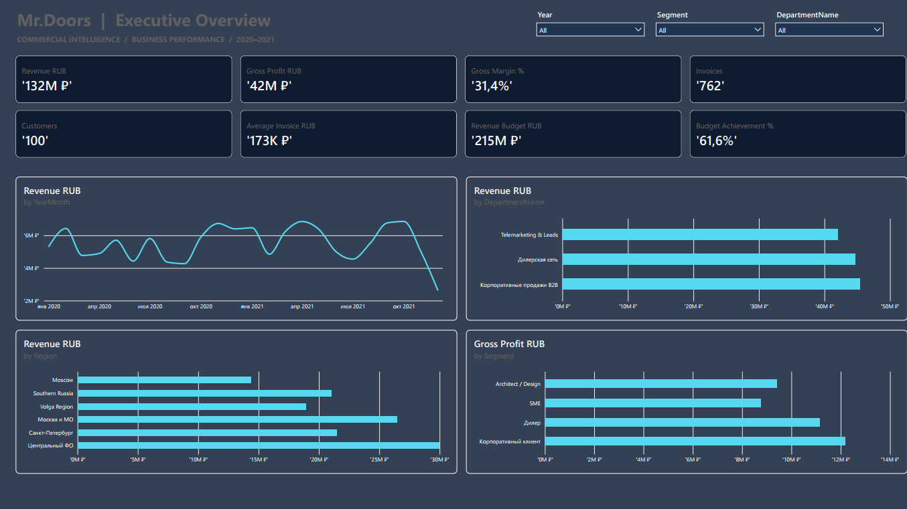
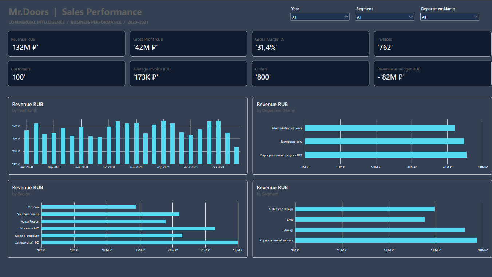
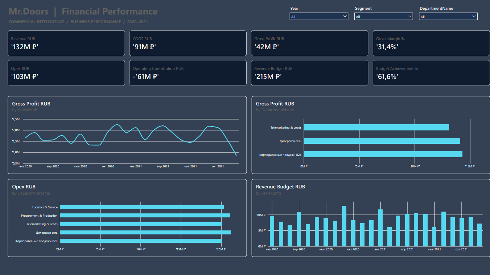
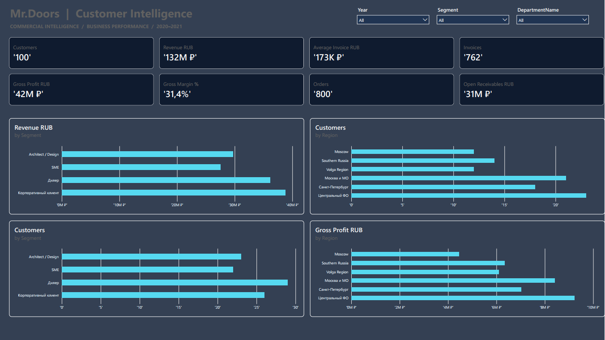
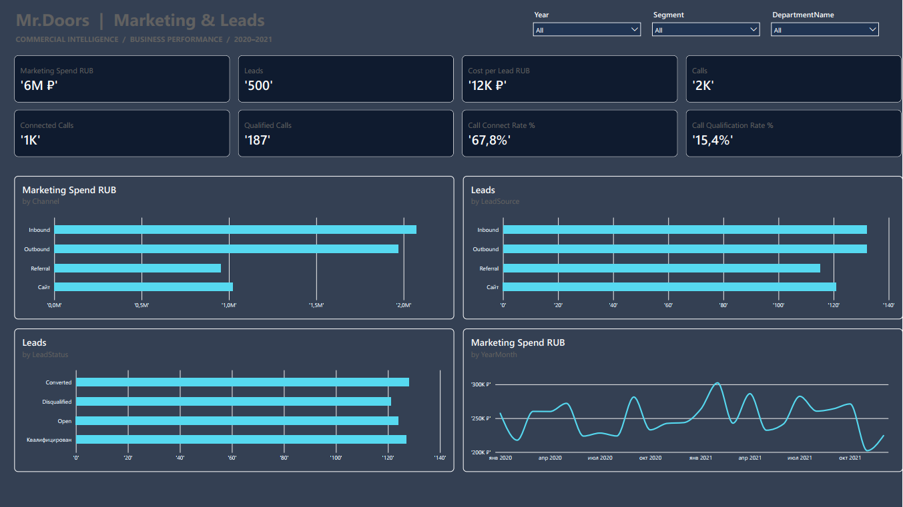
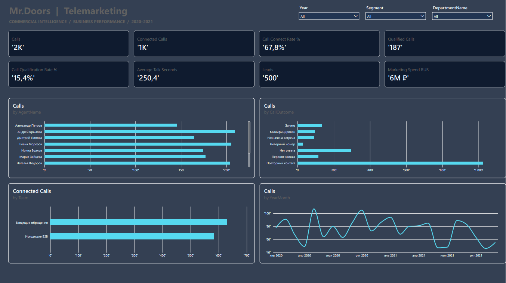
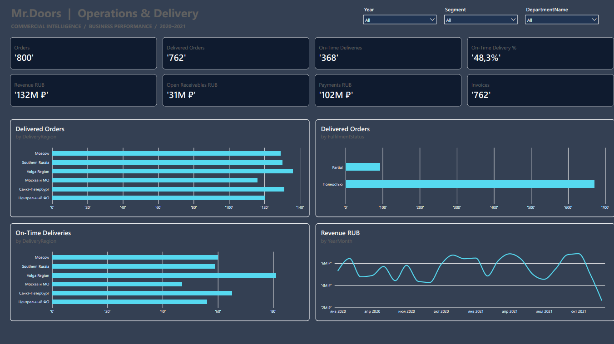
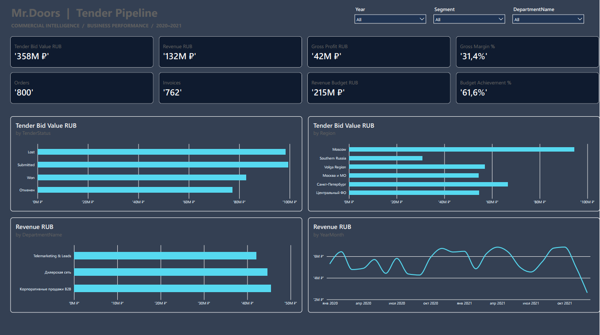

# Mr.Doors | Commercial Intelligence & Business Performance

### Sales · Finance · Customer Intelligence · Marketing · Telemarketing · Operations · Tenders

**Reporting period: 2020–2021 | Power BI dashboard developed: 2026**

**Power BI · SQL · DAX · Data Modeling · Business Intelligence**

[**View dashboards**](#dashboard-gallery) · [**Power BI files**](03_PowerBI/) · [**SQL queries**](02_SQL/) · [**Data dictionary**](05_Documentation/) · [**Validation**](06_Validation/)

---

## Project overview

I worked in business development and marketing analytics at **Mr.Doors** from June 2019 to January 2022. My work involved commercial reporting, performance analysis and supporting decisions across sales and marketing activities.

In 2026, I developed an integrated **eight-page Power BI report** for the 2020–2021 reporting period, bringing together commercial, financial, customer, marketing, telemarketing, delivery and tender analytics.

The project demonstrates my approach to SQL analysis, data modeling, KPI development and interactive business reporting.

## Dashboard gallery

Each screenshot links to its full-size version. The screenshots are static previews; the Power BI file is the interactive report.

### 01 | Executive Overview

A consolidated view of revenue, gross profit, margin, invoice volume, customer base and performance against budget, with comparisons across time, regions, departments and customer segments.

### 02 | Sales Performance

Monthly sales trends, revenue by department, geographic distribution, customer segmentation and variance to budget.

### 03 | Financial Performance

Revenue, cost of goods sold, gross profit, gross margin, operating expenses and budget comparison.

### 04 | Customer Intelligence

Customer distribution by region and segment, revenue contribution, average invoice value and outstanding receivables.

### 05 | Marketing & Leads

Marketing investment by channel, lead sources, lead status, cost per lead and links to contact-center activity.

### 06 | Telemarketing

Call volume, connection and qualification rates, agent activity, call outcomes and team-level performance.

### 07 | Operations & Delivery

Delivery volumes, fulfillment status, on-time performance, geographic coverage, payments and receivables.

### 08 | Tender Pipeline

Tender bid value by status and region, alongside commercial performance indicators. Tender bid value represents pipeline exposure rather than recognized sales revenue.

---

## Business questions

- Which departments, regions and customer segments contribute most to revenue and gross profit?
- How do actual commercial results compare with budget?
- How is marketing investment distributed across channels, and how does it relate to lead generation?
- How do call outcomes and agent activity contribute to qualified contacts?
- Where do delivery performance and outstanding receivables require attention?
- How is the tender pipeline distributed across statuses and regions?

## Data and analytical workflow

The repository contains **19 analytical tables** covering customers, products, orders, sales, invoicing, budgets, expenses, payments, campaigns, leads, calls, deliveries and tenders.

### 1. Reporting requirements

I defined business questions and reporting domains drawing on my commercial analytics experience.

### 2. SQL analysis

SQL scripts provide exploratory aggregations, joins and data-quality checks. The SQLite database allows the queries to be reviewed separately from Power BI.

### 3. Data preparation

The data is organized into dimension and fact tables. Data types, identifiers, date fields and missing values are areas of preparation and validation.

The transformations implemented in the Power BI model can be inspected in Power Query.

### 4. BI modeling

Power BI combines the reporting domains through a semantic model and DAX measures.

The model supports analysis across commercial, financial and operational dimensions.

### 5. Reporting and visualization

Eight themed dashboard pages provide:

- Year, Segment and Department filters
- KPI cards and performance indicators
- Monthly time-series analysis
- Regional and departmental comparisons
- Customer and marketing segmentation
- Financial and operational reporting

### 6. Quality assurance

SQL checks and validation outputs support reconciliation of key totals. Interactive behavior, filtered totals and local refresh can be tested in Power BI Desktop.

SQL scripts document analysis and validation. Power BI source connections can be inspected in Power Query.

---

## Selected dashboard metrics

The report displays the following approximate unfiltered values for the 2020–2021 reporting period:

| KPI | Value |
|---|---:|
| Revenue | ₽132M |
| Gross profit | ₽42M |
| Gross margin | 31.4% |
| Invoices | 762 |
| Revenue budget | ₽215M |
| Budget achievement | 61.6% |

Values are rounded as displayed in Power BI and change with filter selections.

## Key insights and business implications

The published 2020–2021 dataset provides a consolidated view of commercial performance. The following figures use the unfiltered totals recorded in the repository's [QA results](06_Validation/QA_results.json); they are descriptive observations, not causal conclusions.

| Observation | Published result | Business implication |
| --- | ---: | --- |
| Revenue against budget | ₽132.15M actual / ₽214.60M budget (**61.6% attainment**) | Review budget assumptions and identify which periods or departments contribute most to the gap. |
| Gross profitability | ₽41.52M gross profit; **31.4% gross margin** | Track margin alongside revenue to distinguish sales growth from profitable growth. |
| Payments and receivables | ₽101.55M recorded payments; **₽30.60M open balance** | Prioritize receivables monitoring and segment unpaid balances by customer and invoice age before drawing conclusions about collection risk. |
| Marketing investment | **₽6.02M** recorded spend | Compare campaign costs with lead volumes and qualification outcomes to assess channel efficiency. |

**Interpretation:** Revenue is approximately **38.4% below the recorded revenue budget**. The open balance is approximately **23.2% of recorded invoice revenue** at the dataset's reporting snapshot; this is not an overdue-debt rate, because invoice due dates and ageing are not established by these aggregate totals.

### Questions for management

- Which departments and months explain the largest share of the budget variance?
- Are lower-margin segments contributing disproportionately to revenue?
- How much of the outstanding balance is overdue versus not yet due?
- Which marketing channels produce qualified leads at the most efficient cost?

These questions can be investigated with the dashboard filters and underlying data; the aggregate figures above alone do not establish their answers.

## Repository structure

    mrdoors-commercial-intelligence-powerbi/
    |
    |-- 01_Data_CSV/
    |   19 analytical CSV tables
    |
    |-- 02_SQL/
    |   SQL analysis scripts and SQLite database
    |
    |-- 03_PowerBI/
    |   Power BI report, theme and DAX reference
    |
    |-- 04_Dashboards/
    |   Eight dashboard screenshots
    |
    |-- 05_Documentation/
    |   Data dictionary, model and workflow
    |
    |-- 06_Validation/
    |   QA queries, checks and results
    |
    |-- README.md

## How to explore the project

**1. Explore the dashboards**

Browse the eight images above in [04_Dashboards](04_Dashboards/).

**2. Review the data**

Inspect the 19 CSV files in [01_Data_CSV](01_Data_CSV/) and the field definitions in [05_Documentation](05_Documentation/).

**3. Explore SQL**

Open the SQLite database using a compatible tool such as DBeaver and review the analysis and validation scripts in [02_SQL](02_SQL/).

**4. Open the Power BI report**

Download the working `.pbix` file from [03_PowerBI](03_PowerBI/) and open it in Power BI Desktop on Windows.

Update local CSV source paths if prompted, refresh the model and explore the interactive filters.

**5. Review validation**

Compare analytical outputs against the checks and results in [06_Validation](06_Validation/).

---

## Skills demonstrated

- Business Intelligence & Commercial Analytics
- SQL Exploration, Aggregation and Validation
- Dimensional Data Modeling
- Power BI Dashboard Development
- DAX Measures and KPI Design
- Financial and Sales Performance Analysis
- Marketing and Customer Intelligence
- Operational Performance Reporting
- Data Visualization and Storytelling

---

## Author

**Anton Shuleshov**

Business Development & Marketing Analytics  
Business Intelligence & Data Analytics

**GitHub:** [github.com/anton-shuleshov](https://github.com/anton-shuleshov)

**LinkedIn:** [linkedin.com/in/antonshuleshov](https://www.linkedin.com/in/antonshuleshov/)

---

*Dashboard development and portfolio presentation by Anton Shuleshov.*

